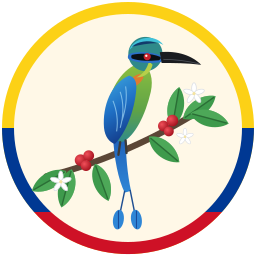

<p align="center"></p>

<h1 align="center">QR Regalo · Carta en PDF por QR</h1>

Programa simple, basado en el diseño de **Catálogo El Regalo**, para armar la carta
(productos, precios, imágenes e ingredientes) en varios idiomas y publicarla como **PDF**
con un **código QR fijo**: se imprime una vez y siempre abre la última versión de la carta,
en el idioma del celular.

## Cómo funciona

1. Escribe el nombre y el lema del restaurante en la cabecera verde.
2. Agrega productos con el formulario: nombre, categoría, precio, descripción,
   ingredientes (Enter o coma para cada uno) y una foto (se recorta cuadrada).
3. Marca con la casilla qué productos van en la carta (los nuevos entran marcados).
4. En **🌐 Idiomas** activa los idiomas (español siempre; inglés, francés, alemán y
   portugués opcionales) y pulsa **✨ Traducir lo que falta**. Revisa y corrige: cada
   producto tiene pestañas de traducción en su formulario.
5. Pulsa **⬆ Publicar carta**: se genera un PDF por idioma con los productos marcados y
   reemplaza la carta publicada. En el diálogo descargas el **QR** (PNG) para imprimirlo.

**El QR es siempre el mismo.** Agrega, cambia o quita productos cuando quieras: todo se
guarda solo, la barra avisa **● cambios sin publicar** y, al pulsar *Publicar carta*, el
mismo QR impreso pasa a mostrar la carta nueva. **📄 Vista previa** muestra el PDF sin
publicarlo (las mesas no ven nada hasta que publiques).

> En GitHub Pages el cambio tarda cerca de un minuto en verse (el diálogo avisa cuando
> está listo); un celular que abrió la carta hace poco puede tardar unos minutos más.

## Idiomas

El QR apunta a la dirección fija de la carta, con un PDF por idioma (`es.pdf`, `en.pdf`, …)
y una página `index.html` que lee el idioma del celular y abre al instante su PDF; si ese
idioma no está activo abre el español (con `#elegir` al final de la dirección muestra los
botones para escoger). Cada PDF lleva arriba a la derecha enlaces **ES · EN · FR …** para
cambiar de idioma.

- Lo que no esté traducido sale **en español**, campo por campo (nunca queda vacío).
  Los ingredientes traducidos solo se usan si la lista está completa.
- El lema y las categorías se traducen una sola vez en la tarjeta **🌐 Idiomas**.
- **Traducción automática**: "Traducir lo que falta" (toda la carta) y "Traducir este
  producto" (formulario) solo rellenan campos vacíos; nunca pisan lo escrito a mano.
  Por defecto usa **MyMemory** (gratis, sin registro, ~5.000 caracteres/día; con
  `MYMEMORY_EMAIL` ~50.000). También admite **LibreTranslate** o **DeepL**, como el
  catálogo (ver `.env.example`).
- Revisa siempre los nombres de platos típicos: a veces es mejor dejarlos en español.

## Publicación web (GitHub Pages)

Para que el QR funcione **desde cualquier red** (datos móviles, cualquier Wi‑Fi) y sin
dejar el PC encendido, los PDF se publican gratis en GitHub Pages:

1. Crea en GitHub un repositorio **público** (puede estar vacío), por ejemplo
   `carta-el-regalo`.
2. Crea un token *fine-grained* en <https://github.com/settings/personal-access-tokens>
   con acceso **solo a ese repositorio** y permisos **Contents** y **Pages** en
   *Read and write*.
3. Copia `.env.example` como `.env` y completa `GITHUB_TOKEN` y `GITHUB_REPO`.

Al pulsar **Publicar carta**, los PDF y la página selectora reemplazan a los anteriores en
la raíz del repositorio en **un solo commit** (si nada cambió no crea commit; los PDF de
idiomas desactivados se borran). Pages se activa solo la primera vez y el QR apunta a
`https://<usuario>.github.io/<repositorio>/`. Funciona con un repositorio vacío. GitHub tarda cerca de un
minuto en desplegar: el diálogo avisa cuando ya está disponible (la dirección no cambia,
así que el QR se puede imprimir enseguida). La barra superior muestra
**🌐 QR en la web** o **⚠️ QR solo en red local** si falta o falla la configuración.

> Todo lo publicado en el repositorio es público: no subas datos privados.

## Ejecutar

```bash
go run .
```

Abre <http://localhost:8090>. Para un binario único (el editor va embebido):

```bash
go build -o qr-regalo . && ./qr-regalo
```

| Variable       | Por defecto                  | Uso                                                     |
|----------------|------------------------------|---------------------------------------------------------|
| `GITHUB_TOKEN` | —                            | Token con Contents y Pages (lectura/escritura).          |
| `GITHUB_REPO`  | —                            | Repositorio público `usuario/nombre` para los PDF.       |
| `PORT`         | `8090`                       | Puerto del servidor.                                    |
| `DATA_DIR`     | `./data`                     | Carta (`carta.json`), fotos (`img/`) y copia publicada (`publicada/`). |
| `BASE_URL`     | `http://<IP-de-la-red>:PORT` | Solo sin GitHub: dirección del QR (misma red Wi‑Fi).     |
| `MYMEMORY_EMAIL` | —                          | Sube el límite diario de la traducción automática.       |
| `LIBRETRANSLATE_URL` / `DEEPL_API_KEY` | —    | Otro proveedor de traducción (tiene prioridad).          |

Las variables se leen del entorno o de un archivo `.env` (el entorno tiene prioridad).

## Estructura

| Archivo          | Contenido                                                    |
|------------------|--------------------------------------------------------------|
| `main.go`        | Servidor HTTP, API, fotos, publicación del PDF y QR.          |
| `github.go`      | Subida de los PDF a GitHub y activación de Pages.             |
| `carta.go`       | Modelo de la carta y guardado en JSON.                        |
| `pdf.go`         | Diseño del PDF por idioma (franja tricolor, cabecera verde, tarjetas). |
| `selector.go`    | Página que abre el PDF según el idioma del celular.           |
| `traductor.go`   | Traducción automática (MyMemory, LibreTranslate o DeepL).     |
| `web/`           | Editor (HTML, CSS y JS sin compilación) y marca de El Regalo. |

## API

| Método y ruta            | Descripción                                          |
|--------------------------|------------------------------------------------------|
| `GET /api/carta`         | Carta completa.                                      |
| `PUT /api/carta`         | Reemplaza la carta.                                  |
| `POST /api/imagenes`     | Sube una foto JPG/PNG (campo `imagen`).              |
| `GET /api/config`        | Dónde se publica (`web` o `local`), idiomas y traductor. |
| `POST /api/traducir`     | Traduce `{"destino": "en", "textos": [...]}` del español. |
| `POST /api/publicar`     | Reemplaza la carta publicada (PDF por idioma + selector). |
| `GET /api/estado`        | Si hay cambios sin publicar.                         |
| `GET /api/vista/{es}.pdf` | Vista previa de un idioma, sin publicar.            |
| `GET /api/disponible/{version}` | Si internet ya muestra esa versión.          |
| `GET /api/qr`            | QR fijo en PNG (`?descargar=1` para guardarlo).      |
| `GET /carta/`            | Página selectora de idioma (copia local).            |
| `GET /carta/{es}.pdf`    | PDF publicado de un idioma (`?ver=1` lo muestra).    |
